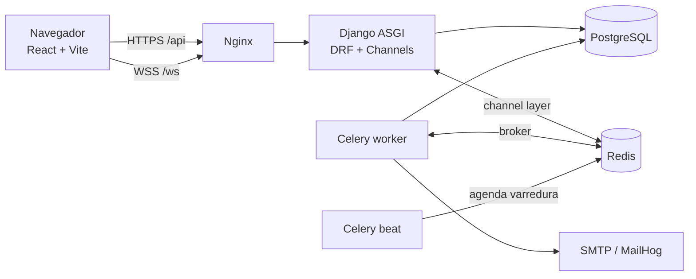
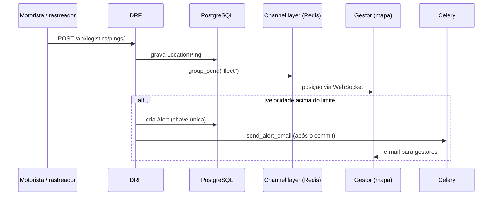

# Arquitetura

## Visão geral

| Componente | Responsabilidade |
|---|---|
| **Django REST Framework** | API REST, validação, permissões por perfil, filtros e paginação |
| **Django Channels** | WebSocket `/ws/fleet/` com a posição dos veículos em tempo real |
| **Celery + Redis** | E-mails (confirmação, reset, alertas) e varredura periódica de alertas, fora do ciclo da requisição |
| **PostgreSQL** | Dados relacionais; `DISTINCT ON` para "última posição por veículo" |
| **Nginx** | Serve o build do React, faz proxy de `/api`, `/admin`, `/ws` e entrega estáticos do admin |

## Módulos do backend (`backend/apps`)

| App | Conteúdo |
|---|---|
| `accounts` | **Empresa (`Organization`)**, usuário customizado (login por e-mail), perfis, JWT, verificação de e-mail, reset de senha, convites, autenticação do WebSocket |
| `fleet` | Veículos, motoristas e manutenções |
| `logistics` | Viagens (máquina de estados), pings de GPS, mapa ao vivo, dashboard |
| `alerts` | Regras de alerta, deduplicação, e-mails |
| `audit` | Trilha de auditoria imutável (quem, o quê, quando, IP, request-id) |
| `core` | Logs estruturados, `X-Request-ID`, health checks, mixins de isolamento por empresa (`tenancy.py`) |

## Fluxo: posição de GPS → mapa e alerta

## Estados da viagem

`PLANNED → IN_PROGRESS → COMPLETED`, com `CANCELLED` a partir de PLANNED ou IN_PROGRESS.
Cada transição altera também a situação do veículo (`IN_USE` ↔ `AVAILABLE`) na mesma transação e gera um registro de auditoria.

## Multi-empresa (multi-tenant)

Modelo de **banco único e esquema compartilhado**: toda tabela de negócio tem `organization_id`.
O isolamento é aplicado em quatro camadas, todas cobertas por testes (`tests/test_tenancy.py`):

| Camada | Como |
|---|---|
| Leitura | `TenantQuerysetMixin` filtra todo queryset pela empresa do usuário; objeto de outra empresa responde **404** (não 403, para não revelar que existe) |
| Escrita | a empresa de um registro novo vem do usuário logado; o campo `organization` é somente leitura na API |
| Relações | `TenantSerializerMixin` limita campos como `vehicle`, `driver` e `trip` a objetos da mesma empresa (impede referenciar o id de outra empresa) |
| Tempo real e e-mail | um grupo de WebSocket por empresa (`fleet-<id>`); alertas herdam a empresa e só notificam gestores dela |

Unicidade (placa, CNH) é **por empresa**: duas empresas podem ter o mesmo veículo cadastrado. O superusuário da plataforma não pertence a nenhuma empresa e acessa apenas o `/admin`.

## Modelo de permissões

| Perfil | Escopo |
|---|---|
| ADMIN | Tudo do gestor + equipe (convidar, alterar perfil, desativar usuários) |
| MANAGER | CRUD de frota e viagens, mapa, alertas, auditoria; consulta a equipe |
| DRIVER | Lê frota; vê **só as próprias** viagens; inicia/conclui viagem; envia GPS do veículo da própria viagem em andamento |

A restrição do motorista é aplicada no `queryset` (não só na tela), então um motorista recebe 404 para viagens alheias.

## Ambientes

- **Dev:** `docker-compose.yml` (hot reload, MailHog, pytest/ruff na imagem).
- **Prod (referência):** `docker-compose.prod.yml` com imagens multi-stage, usuário sem root, health checks e migrações em serviço dedicado.
- **CI:** `.github/workflows/ci.yml` (lint, migrações em dia, testes com PostgreSQL, build do front e das imagens).

## Evolução prevista

1. Row-level security no PostgreSQL como segunda barreira de isolamento.
2. Cercas geográficas e PostGIS para consultas espaciais.
3. Métricas Prometheus e traces distribuídos.
4. Ingestão de telemetria em lote com chave de API por dispositivo.
5. Planos e limites por empresa; um usuário em várias empresas (memberships).
